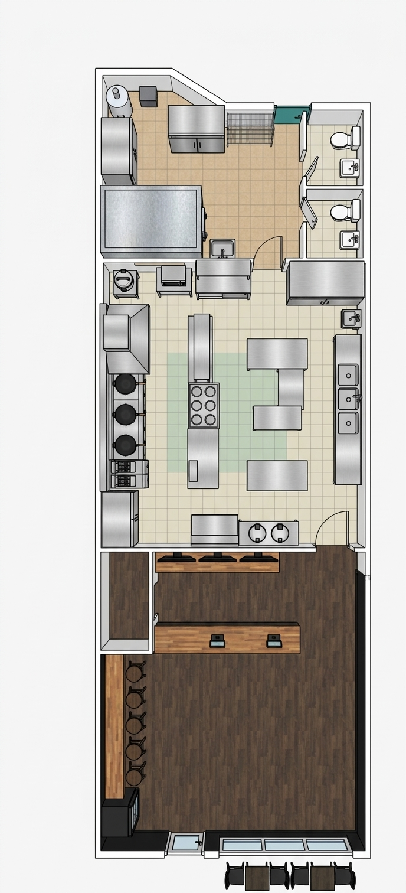
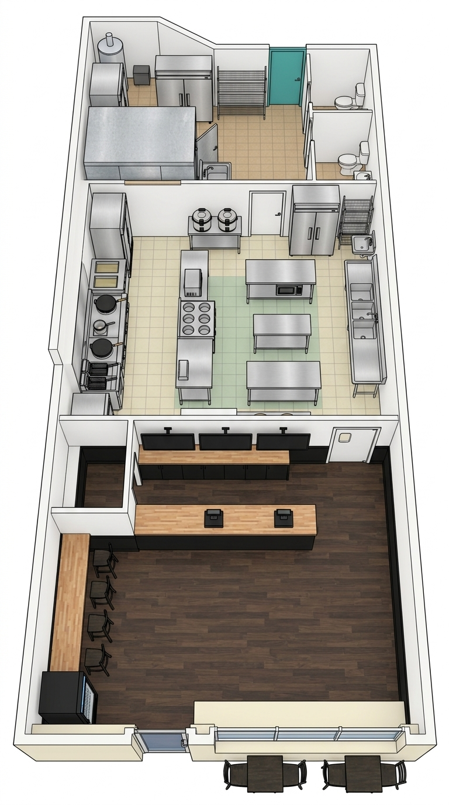
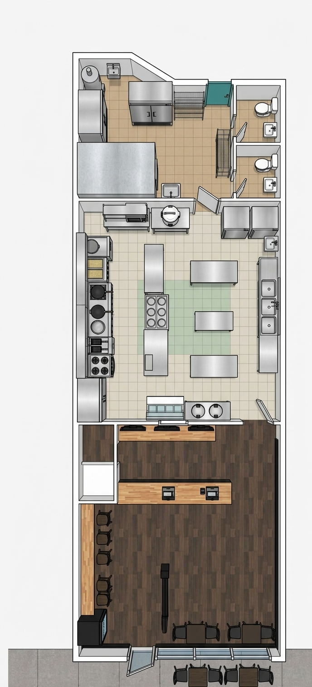
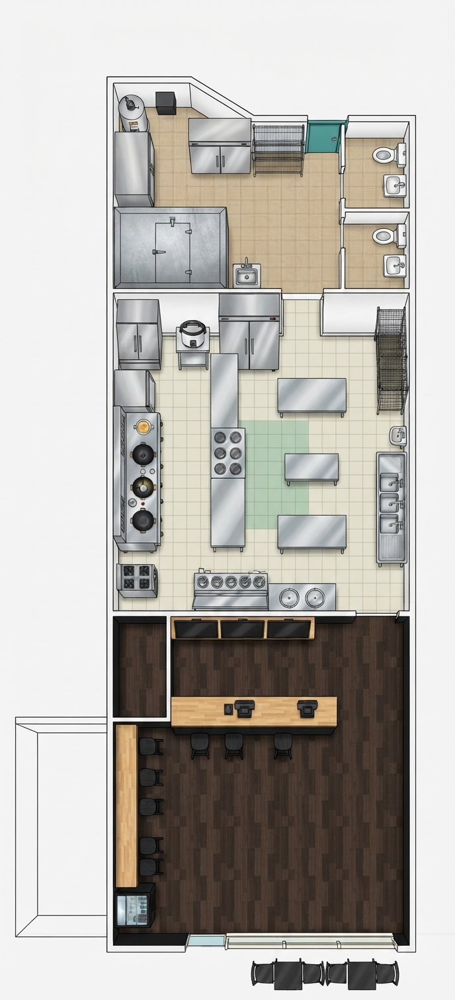
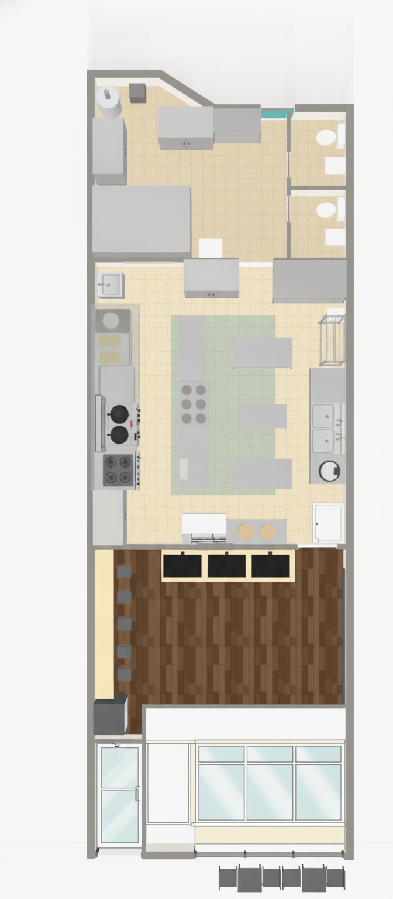

# Gemini Image Models — Kitchen Floorplan Reference + Prompt Benchmark

This repository benchmarks all current Gemini image generation models on an **image-to-image architectural redraw task** using the `gemini-api` CLI (`POST /v1beta/interactions`).

Each model is given the **exact same two inputs**:
1. **Input Reference Image:** [`Screenshot 2026-10-01 at 2.19.42 AM.jpeg`](./Screenshot%202026-10-01%20at%202.19.42%E2%80%AFAM.jpeg) — an untextured 3D overhead floorplan blockout of a restaurant kitchen and dining room.
2. **Input Text Prompt:** [`prompt-image01.md`](./prompt-image01.md) — strict architectural illustration redraw instructions specifying materials, equipment types, and exact item counts while preserving the layout and geometry of the reference image.

---

## Documentation & Scripts

- **[`prompt-image01.md`](./prompt-image01.md)** — The full architectural illustration redraw prompt and object count checklist.
- **[`run-image-models-test.sh`](./run-image-models-test.sh)** — Batch test script that base64-encodes the reference image, pairs it with [`prompt-image01.md`](./prompt-image01.md), and runs `gemini-api image --body @-` across all 5 image models, saving outputs to [`images/`](./images).
- **[`image-models-index.md`](./image-models-index.md)** — Detailed index of all parameters, JSON request payloads, model IDs, pixel dimensions, MIME types, and file sizes.
- **[`bug-report-ref-image.md`](./bug-report-ref-image.md)** — CLI ergonomics analysis, current `--body` workarounds, and recommendations for adding `-i / --input` support to `gemini-api image`.

---

## Quick Start

Assuming `gemini-api` is installed and `GEMINI_API_KEY` is configured:

```bash
./run-image-models-test.sh
```

This generates one output image per model inside [`images/`](./images), named directly after the model ID.

---

## Visual Comparison: Input vs. All 5 Image Models

| Input Reference Image | `nano-banana-pro-preview` | `gemini-3-pro-image` |
| :---: | :---: | :---: |
|  |  |  |
| [`Screenshot 2026-10-01 at 2.19.42 AM.jpeg`](./Screenshot%202026-10-01%20at%202.19.42%E2%80%AFAM.jpeg)<br>`656 × 1442` · JPEG | [`images/nano-banana-pro-preview.jpg`](./images/nano-banana-pro-preview.jpg)<br>`688 × 1512` · JPEG | [`images/gemini-3-pro-image.jpg`](./images/gemini-3-pro-image.jpg)<br>`768 × 1376` · JPEG (`9:16`) |

| `gemini-3.1-flash-image` | `gemini-3.1-flash-lite-image` | `gemini-2.5-flash-image` |
| :---: | :---: | :---: |
|  |  |  |
| [`images/gemini-3.1-flash-image.jpg`](./images/gemini-3.1-flash-image.jpg)<br>`688 × 1512` · JPEG | [`images/gemini-3.1-flash-lite-image.jpg`](./images/gemini-3.1-flash-lite-image.jpg)<br>`688 × 1512` · JPEG | [`images/gemini-2.5-flash-image.png`](./images/gemini-2.5-flash-image.png)<br>`672 × 1536` · PNG |

---

## Model-by-Model Notes

1. **[`nano-banana-pro-preview`](./images/nano-banana-pro-preview.jpg)** (`Gemini 3 Pro Image Preview`)
   - **Best overall fidelity.** Preserves the exact overhead camera angle and building footprint, renders both top-right staff restrooms with 1 toilet and 1 sink each, places wire shelving next to the back-wall freezer, keeps the front-left alcove empty and white, renders 2 POS terminals with **0 stools** at the order counter, places 5 bar stools along the left wall, and draws 2 outdoor tables with 4 chairs.
2. **[`gemini-3-pro-image`](./images/gemini-3-pro-image.jpg)** (`Gemini 3 Pro Image`)
   - High-detail architectural rendering pinned to `9:16` portrait (`generation_config.image_config.aspect_ratio = "9:16"`). Preserves the vertical room structure, 2 staff restrooms, walk-in cooler, cook line, 3 center tables on the pale green tile patch, 3 menu TVs, 2 POS terminals with 0 order-counter stools, left bar stools, and 2 outdoor tables with 4 chairs.
3. **[`gemini-3.1-flash-image`](./images/gemini-3.1-flash-image.jpg)** (`Gemini 3.1 Flash Image` — default model in `gemini-api image`)
   - Preserves the exact overhead footprint, both top-right restrooms, kitchen layout, and removes the order-counter stools, with minor hallucinations (adds an extra wire rack in the back hallway and 2 small indoor tables near the bottom window).
4. **[`gemini-3.1-flash-lite-image`](./images/gemini-3.1-flash-lite-image.jpg)** (`Gemini 3.1 Flash Lite Image`)
   - Preserves the vertical footprint and both top-right restrooms, but adds an extra white box protruding outside the lower-left wall and places 3 stools in front of the order counter.
5. **[`gemini-2.5-flash-image`](./images/gemini-2.5-flash-image.png)** (`Gemini 2.5 Flash Image`)
   - Outputs `image/png` (automatically renamed from `.jpg` to `.png` by `gemini-api`). Performs minimal restyling, leaving most of the original untextured 3D blockout intact and only modifying isolated fixtures.
